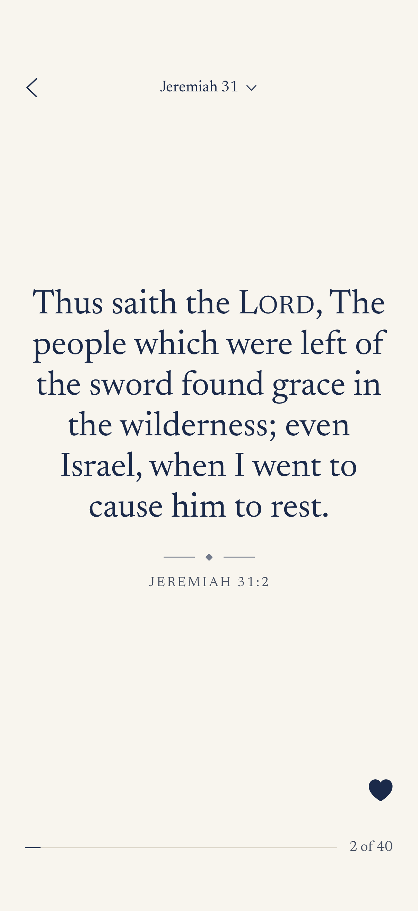
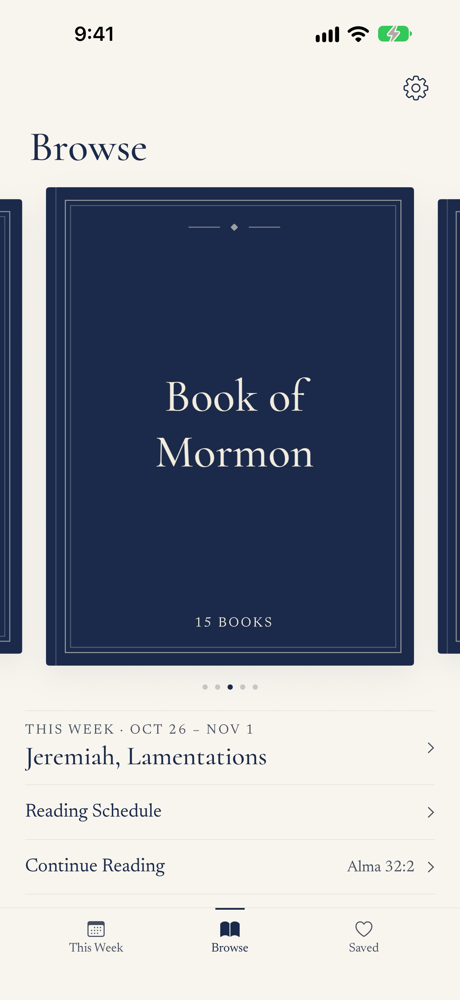
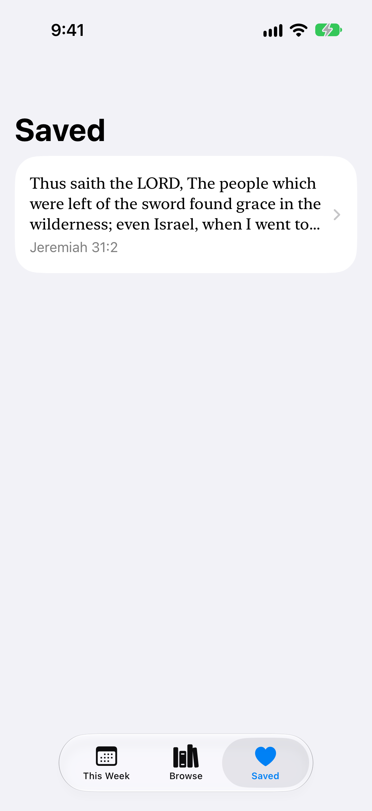

# Versed

An iPhone app for reading scripture one verse at a time. Swipe up for the next verse, like a short-video feed.

Built for Latter-day Saints who want to read a little every day. It opens straight to this week's Come, Follow Me reading.

<p>
  
  
  
</p>

## Features
- One verse per screen, with a title card at the start of each chapter
- Opens to this week's reading; pick any other week from a menu
- Browse any book and chapter of the standard works
- Save verses with a double-tap or the heart button
- Picks up where you left off
- Daily reading streak
- Light or dark mode, or match the phone (Settings, from the gear on the Browse tab)
- An optional daily reminder at a time you pick (off until you turn it on)
- A button on each week's intro card that opens the official lesson, in Gospel Library if it's installed
- A short first-time intro, which can be replayed from Settings

Everything stays on your phone. No account, no ads, no tracking, no internet needed. See the [privacy policy](PRIVACY.md).

## Built with
- SwiftUI (iOS 17)
- [XcodeGen](https://github.com/yonaskolb/XcodeGen): the Xcode project is generated from `project.yml`

## Running it
Open `Versed.xcodeproj` in Xcode, pick an iPhone simulator, and press Run (⌘R).

After changing `project.yml`, run `xcodegen` to rebuild the project.

Run the tests with ⌘U. There are two kinds:
- **Unit tests** (`VersedTests`) check the pieces on their own: loading scripture, the weekly schedule and its lesson links, saved verses, reading position, the streak, the reminder time, and the About section.
- **UI tests** (`VersedUITests`) drive the app like a reader: swipe through this week's reading, save a verse, browse to a chapter, resume with Continue Reading, check the Saved tab, switch between light and dark mode, turn the daily reminder on and off, go through the first-time intro, and check the About section. They launch the app with `-ui-testing`, so reading data starts fresh and real data is never touched.

The UI test also takes the screenshots above. To refresh them:

```sh
TEST_RUNNER_SCREENSHOT_DIR="$PWD/docs/screenshots" xcodebuild test -project Versed.xcodeproj -scheme Versed -destination 'platform=iOS Simulator,name=iPhone 17'
```

The app icon is drawn by `Scripts/make_app_icon.swift`. Run `swift Scripts/make_app_icon.swift` to redraw it.

## Credits
Scripture text is public domain, from [bcbooks/scriptures-json](https://github.com/bcbooks/scriptures-json) (commit `3bda76e`). `Scripts/build_scriptures.py` converts it into the compact files in `Versed/Resources/Scriptures/`.

Versed is an independent app. It is not made, approved, or endorsed by The Church of Jesus Christ of Latter-day Saints.

Questions: [peytoncall32@icloud.com](mailto:peytoncall32@icloud.com)
